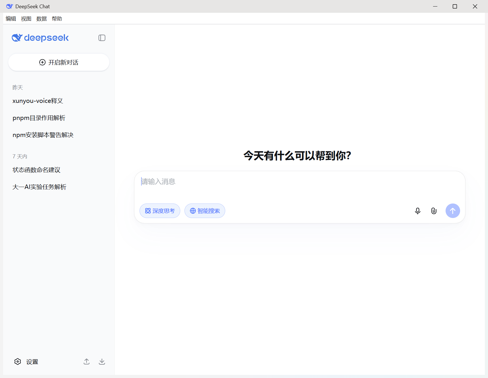

# DeepSeek Chat 便携桌面版

把 DeepSeek 官方开源的 [chat-demo](https://github.com/deepseek-ai/chat-demo) 前端，封装成一个
**Windows 免安装桌面客户端**：双击即用、对话只存在本地、API Key 填一次就记住。

> **非官方项目**。与 DeepSeek 官方无隶属或背书关系，仅作技术演示与个人使用。
> 商标与品牌归属见 [NOTICE](NOTICE)。



## 为什么做这个

网页版 demo 的对话记录存在浏览器里，换个入口、清一次缓存就"丢"了；而且每次都要重新填 API Key。
这个壳把数据固定落在程序旁边的 `data\` 目录，并给窗口加了原生感和主题适配——本质是**把网页版变成软件**。

## 特性

- **免安装**：解压即可运行，不依赖 Node / 运行库；整个文件夹拷走即带走全部对话
- **数据本地化**：对话、附件、设置全在 `data\`，不经过任何中间服务器
- **API Key 只填一次**：Windows DPAPI 加密另存一份，启动自动注入
- **UI 与网页版一致**：上游前端几乎未改（改动清单见 [docs/项目记录.md](docs/项目记录.md)）
- **原生标题栏着色**：Win11 下标题栏跟随界面配色，不再显示系统主题色
- **跟随系统深浅色**，菜单栏同步切换
- **导入 / 导出**：侧边栏一键导出 ZIP（与网页版格式互通），导入前有覆盖确认
- **便携分发**：删掉 `data\` 即可作为干净副本发给别人

## 直接用

到 [Releases](../../releases) 下载压缩包，解压后双击 `DeepSeek Chat.exe`。
首次启动会提示填 API Key（在 [platform.deepseek.com](https://platform.deepseek.com/api_keys) 创建）。

> 未签名程序，首次运行可能触发 SmartScreen：点「更多信息」→「仍要运行」。
> 需要 Windows 10/11 x64。

## 从源码构建

环境：Windows 10/11 x64、Node.js 22+、git。

```powershell
git clone <本仓库地址>
cd <仓库目录>

# 1) 前端依赖
cd chat-demo
npm install
cd ..

# 2) 外壳依赖（Electron 体积较大，国内建议配镜像）
cd app
$env:ELECTRON_MIRROR = 'https://npmmirror.com/mirrors/electron/'
npm install
cd ..

# 3) 一键构建
.\build.ps1            # 产物在 dist-out\win-unpacked；若父目录已有程序则自动覆盖部署
.\build.ps1 -NoDeploy  # 只构建，不部署
```

构建脚本会依次：构建前端 → 拷贝到 `app\web` → electron-builder 打包 →
用 rcedit 写入图标与版本信息 →（可选）部署并裁剪语言包。
`rcedit` 缺失时会自动从 npmmirror 获取（见 `tools/get-rcedit.ps1`）。

### 目录结构

```
app/             Electron 外壳（main.js / preload.js / 打包配置）
chat-demo/       上游前端（仅少量改动）
tools/           rcedit 获取脚本、图标生成脚本
docs/            开发记录、回归检查清单、截图
build.ps1        一键构建
```

## 数据与隐私

| 内容 | 位置 | 说明 |
|---|---|---|
| 对话、附件 | `data\IndexedDB` | 唯一副本，删掉即彻底清空 |
| 设置、API Key | `data\Local Storage` | Key 在这里是明文，**不要连同 data 一起分发** |
| Key 加密副本 | `data\secret.dat` | DPAPI，绑当前 Windows 账户 |

**分发前务必删除 `data\`**，否则会把你的 API Key 和全部对话一起发出去。

请求只发往 `api.deepseek.com`，无遥测、无第三方服务。

## 已知限制

- 仅 Windows x64；标题栏着色需要 Win11（22000+），Win10 会回退系统配色
- 依赖 koffi 原生模块做 DWM 调用；加载失败时同样回退，不影响使用
- 未签名，无自动更新
- 切回焦点时标题栏偶发闪一帧系统色（已加密集补偿，未完全消除，见 `docs/项目记录.md`）

## 许可

本项目代码遵循 [MIT](LICENSE)。前端部分来自 deepseek-ai/chat-demo（MIT），
商标与图标归属见 [NOTICE](NOTICE)。

---

## English

A portable Windows desktop wrapper around DeepSeek's official open-source
[chat-demo](https://github.com/deepseek-ai/chat-demo) frontend: no installer, local-only
conversation storage, DPAPI-encrypted API key, and a native title bar tinted to match the app.
Unofficial project, not affiliated with DeepSeek. MIT licensed; see [NOTICE](NOTICE) for
third-party attribution.